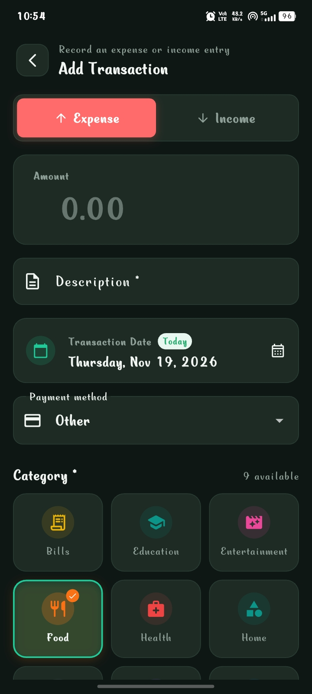
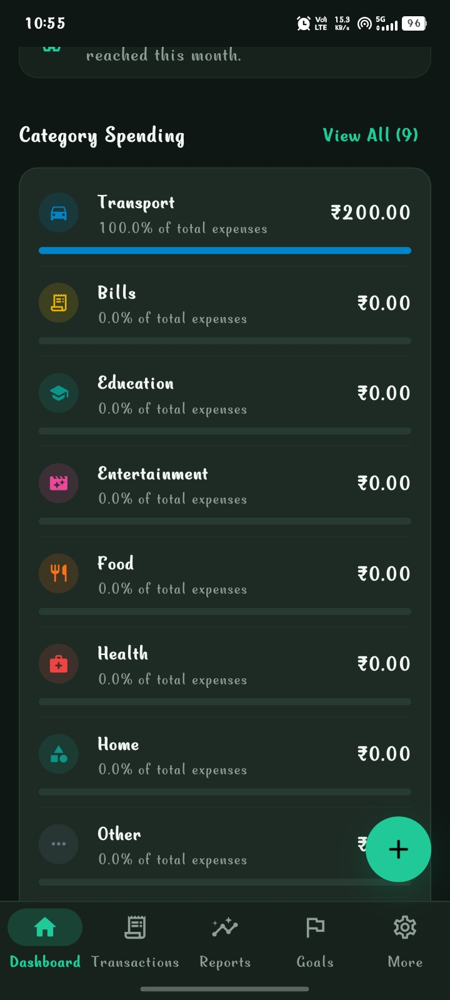
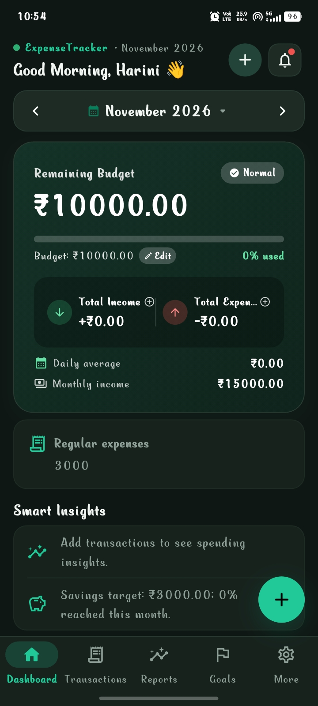
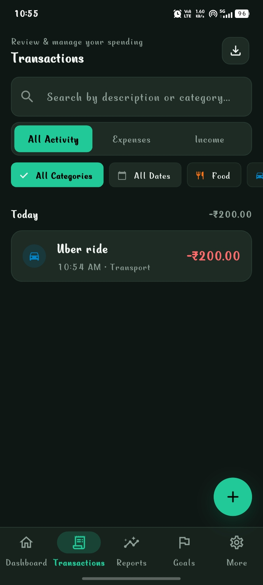
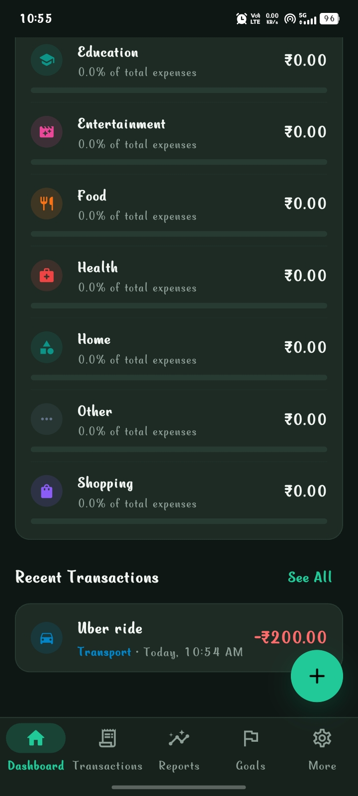

# 💰 ExpenseTracker

A Flutter-based personal expense tracking application that helps users manage daily expenses, monitor monthly budgets, categorize transactions, and track spending history.

The application uses Firebase Authentication for secure user access and provides an intuitive interface for managing personal finances.

## 📱 Application Screenshots

Add your Android emulator screenshots in the `screenshots/` folder.

| Transaction Logging | Budget Summary | Transaction History |
|---|---|---|
|  |  |  | | | |
| Add and record expenses | Monitor monthly spending | View previous transactions |

## ✨ Key Features

### 1. Transaction Management
- Add daily expenses.
- Enter transaction amount and description.
- Select expense categories with icons.
- Record transaction dates.
- Edit existing transactions.
- Delete unwanted transactions.

### 2. Monthly Budget Summary
- Display total monthly expenses.
- Set a monthly spending budget.
- Calculate remaining budget.
- Display category-wise spending percentages.
- Monitor spending progress.

### 3. Transaction History
- Display all recorded transactions.
- Organize transactions chronologically.
- Show transaction amount, category, and date.
- Support editing and deleting transactions.

### 4. Firebase Authentication
- Email and password registration.
- Secure login and logout.
- Password reset.
- Google sign-in.
- Apple sign-in.
- Facebook sign-in.
- Microsoft sign-in.
- Persistent authentication sessions.

## 🛠️ Technology Stack

| Technology | Purpose |
|---|---|
| Flutter | Cross-platform application development |
| Dart | Programming language |
| Firebase Authentication | User authentication |
| Firebase Core | Firebase initialization |
| Cloud Firestore / Local Storage | Transaction storage (depending on implementation) |
| Material Design | User interface |

## 📂 Data Schema

The following is the recommended transaction data structure.

### Transaction Schema

| Field | Data Type | Description |
|---|---|---|
| id | String | Unique transaction ID |
| userId | String | Authenticated user's UID |
| amount | Double | Expense amount |
| description | String | Transaction description |
| category | String | Expense category |
| date | DateTime | Transaction date |
| createdAt | Timestamp | Record creation time |

### Example Transaction

```json
{
  "id": "transaction_001",
  "userId": "firebase_user_uid",
  "amount": 250.00,
  "description": "Lunch",
  "category": "Food",
  "date": "2026-11-19",
  "createdAt": "2026-11-19T10:30:00Z"
}
```

### Budget Schema

| Field | Data Type | Description |
|---|---|---|
| id | String | Unique budget ID |
| userId | String | User UID |
| monthlyBudget | Double | Monthly spending limit |
| month | Integer | Budget month |
| year | Integer | Budget year |

## 🧮 Budget Calculation Logic

The application calculates monthly spending using the user's recorded transactions.

**1. Total Monthly Expenses**

```text
Total Expenses = Sum of all transaction amounts
                 within the selected month
```

**2. Remaining Budget**

```text
Remaining Budget = Monthly Budget - Total Expenses
```

**3. Category-wise Spending**

```text
Category Percentage =
(Category Total / Total Monthly Expenses) × 100
```

**4. Budget Utilization**

```text
Budget Utilization =
(Total Expenses / Monthly Budget) × 100
```

### Example Calculation

Assume the monthly budget is ₹10,000.

| Category | Amount |
|---|---:|
| Food | ₹2,000 |
| Transport | ₹1,000 |
| Shopping | ₹1,500 |
| Entertainment | ₹500 |
| Others | ₹1,000 |
| **Total Expenses** | **₹6,000** |

**Budget Summary:**

- Monthly Budget: ₹10,000
- Total Expenses: ₹6,000
- Remaining Budget: ₹4,000
- Budget Utilization: 60%

## 🔥 Firebase Configuration

The application uses Firebase Authentication.

Firebase Project ID:

```text
expensetracking-1d98f
```

### Enable Authentication

1. Open Firebase Console.
2. Select the ExpenseTracker project.
3. Navigate to Authentication.
4. Open Sign-in method.
5. Enable Email/Password authentication.
6. Configure additional providers if required.

### Supported Authentication Providers

- Email/Password
- Google
- Apple
- Facebook
- Microsoft

**Note:** Social authentication requires additional OAuth configuration in the respective provider consoles.

### Firebase Android Configuration

The Android application ID is:

```text
com.expensetracker.app
```

Configuration file:

```text
android/app/google-services.json
```

Firebase initialization:

```text
lib/firebase_options.dart
```

## 🚀 Installation and Setup

### Prerequisites

- Flutter SDK
- Dart SDK
- Android Studio
- Visual Studio Code
- Firebase account

### Step 1: Clone Repository

```bash
git clone YOUR_GITHUB_REPOSITORY_URL
```

### Step 2: Navigate to Project

```bash
cd ExpenseTracker
```

### Step 3: Install Dependencies

```bash
flutter pub get
```

### Step 4: Configure Firebase

Ensure the Firebase configuration files are available and correctly configured for your target platform.

### Step 5: Run Application

```bash
flutter run
```

To run on a specific Android device:

```bash
flutter devices
flutter run -d DEVICE_ID
```

## 📸 Adding Emulator Screenshots

Create the following folder structure:

```text
ExpenseTracker/
│
├── screenshots/
│   ├── transaction_logging.png
│   ├── budget_summary.png
│   └── transaction_history.png
│
├── android/
├── lib/
├── ios/
├── web/
├── pubspec.yaml
└── README.md
```

Capture screenshots from your Android emulator and save them using the filenames shown above.

## 🔮 Future Enhancements

- Interactive expense analytics and charts.
- Weekly and yearly spending reports.
- Customizable expense categories.
- Monthly budget notifications.
- Export transactions as PDF or Excel.
- Recurring expense management.
- Cloud synchronization across devices.

## 👩‍💻 Developer

**Harini**

B.Tech – Artificial Intelligence and Data Science

---

⭐ If you find this project useful, consider giving it a star!